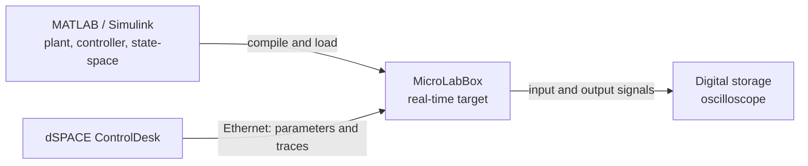
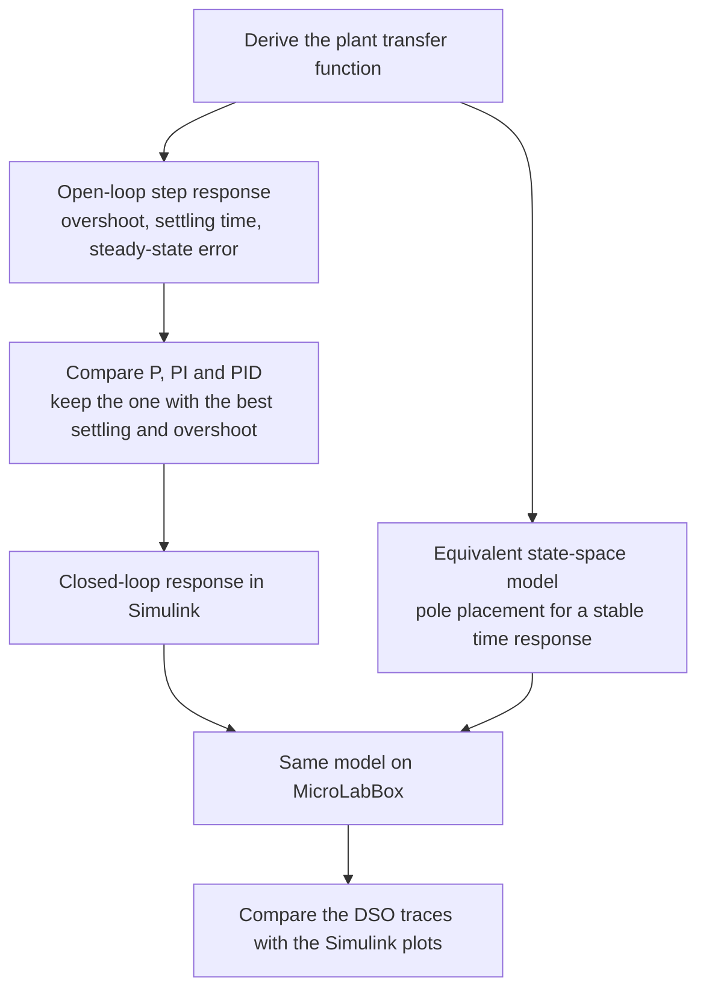
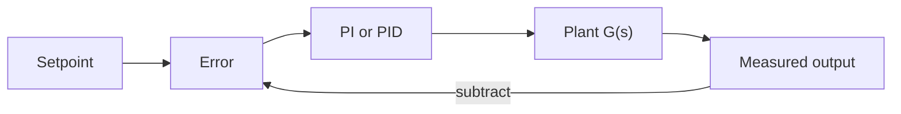

# Real-Time Simulation of Vehicle Dynamics

Real-time, hardware-in-the-loop simulation of five automotive control systems (suspension, cruise control, anti-lock braking, motor speed and throttle) on a **dSPACE MicroLabBox**, modelled in **MATLAB/Simulink** and verified on a digital storage oscilloscope.

> 📄 **Patent pending:** Indian Patent Application No. **202321073605**, *"System and Method for Real Time Simulation of Vehicle Control Systems"* (filed October 2023). See the [filing receipt](docs/Patent-Filing-Receipt.pdf).

B.E. final-year project, Department of Electronics Engineering, Ramrao Adik Institute of Technology (University of Mumbai), April 2023.

## How it works

Each controller is built the same way, then run on the same bench.





The closed loop is ordinary feedback. The controller is PI for suspension, cruise control and motor speed, and PID for ABS and throttle.



| System | What is controlled | Controller | Plant, from the report | Open-loop behaviour the controller fixes |
|---|---|---|---|---|
| Suspension (bus quarter-car) | Body motion after a road step, such as leaving a pothole | PI | 4th order, eq. 4.1 | Underdamped: oscillation and a very long settling time |
| Cruise control | Vehicle speed | PI | \(1/(1000s+50)\), eq. 4.2 | Stable, no overshoot, rise time too slow. Pole at \(-0.05\) |
| Anti-lock braking | Brake pressure so the wheel does not lock | PID | \(10/(s^2+0.7s+0.1)\), eq. 4.3 | Stable, no oscillation, rise time too slow |
| DC motor speed | Shaft speed | PI | \(0.01/(0.005s^2+0.06s+0.1001)\), eq. 4.4 | No overshoot. Poles at \(-2\) and \(-10\); the pole at \(-2\) sets the speed |
| Throttle | Throttle position | PID | \(1/(s^2+s+1.1)\), eq. 4.5 | Underdamped. Poles at \(-0.5 \pm 0.922j\) |

Suspension plant (report equation 4.1), force to sprung-mass displacement:

\[
G(s)=\frac{2820s^{2}+15020s+500000}{800000s^{4}+3.854\times10^{7}s^{3}+1.481\times10^{9}s^{2}+1.377\times10^{9}s+4\times10^{10}}
\]

On the hardware, each transfer function is also written as a state-space model (four states for suspension, one for cruise control, two for ABS, motor speed and throttle). Closed-loop poles are placed so the time response stays stable, and those traces are read on the oscilloscope next to the Simulink plots.

## Why

Modern vehicles run many interacting control loops, and most simulations of them run offline. This project builds each loop as a real-time model on automotive-grade prototyping hardware, so open-loop and closed-loop behaviour can be compared live, the same way the industry prototypes and tests controllers.

## What's inside

| System | Controller | Goal |
|---|---|---|
| Suspension (bus quarter-car model) | PI | Damp body oscillation from road bumps for ride comfort |
| Cruise control | PI | Hold a set speed against load changes |
| Anti-lock braking (ABS) | PID | Regulate wheel slip so wheels don't lock under hard braking |
| DC motor speed | PI | Track a target speed with low steady-state error |
| Throttle | PID | Fast, low-overshoot throttle position response |

For each system we:

1. Derived the plant **transfer function** and an equivalent **state-space model**.
2. Simulated the **open-loop** response to show the problem (overshoot, long settling time, steady-state error).
3. Tuned P, PI and PID controllers and chose the one with the best settling time and overshoot.
4. Built the model in Simulink, compiled it for **dSPACE MicroLabBox** with ControlDesk, and ran it in real time, reading the input and output signals on a DSO.

## Tech stack

- **Hardware:** dSPACE MicroLabBox, digital storage oscilloscope
- **Software:** MATLAB, Simulink, dSPACE ControlDesk / Real-Time Interface
- **Methods:** transfer functions, state-space modelling, PID tuning, open- vs closed-loop analysis

## Results

Closing the loop cut overshoot and settling time across all five systems compared with their open-loop responses. Full plots, block diagrams and controller parameters are in the [project report](docs/Real-Time-Simulation-of-Vehicle-Dynamics-Report.pdf) (chapters 4 and 5).

## Repository layout

```
.
├── README.md
└── docs/
    ├── Real-Time-Simulation-of-Vehicle-Dynamics-Report.pdf
    └── Patent-Filing-Receipt.pdf
```

## Future work

- Advanced controllers: model predictive control, adaptive control, fuzzy logic
- Richer hardware-in-the-loop testing that models the full vehicle and its environment
- Running the controller and plant on separate hardware (DSP, microcontroller or FPGA alongside dSPACE)

## Team

- **Heramb Bhor** ([heramb.work](https://heramb.work))
- Akanksha Bhavsar
- Mansi Ghag

Guide: Prof. Vishwesh A. Vyawahare · Co-guide: Dr. Prasiddh Trivedi

## License

© 2023 the authors. The report is shared for reference only; the underlying method is the subject of a pending patent application. Please contact the authors before reusing it.
